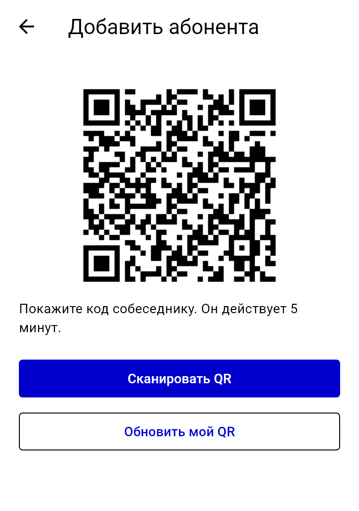
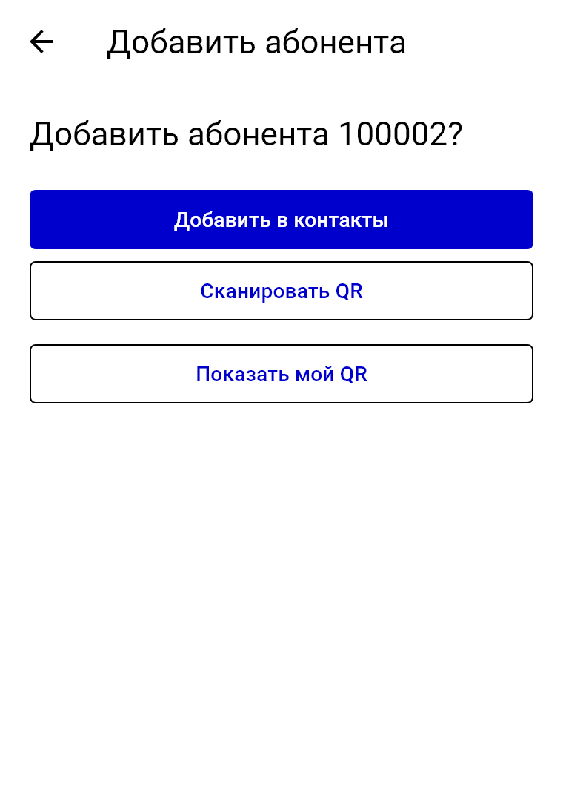
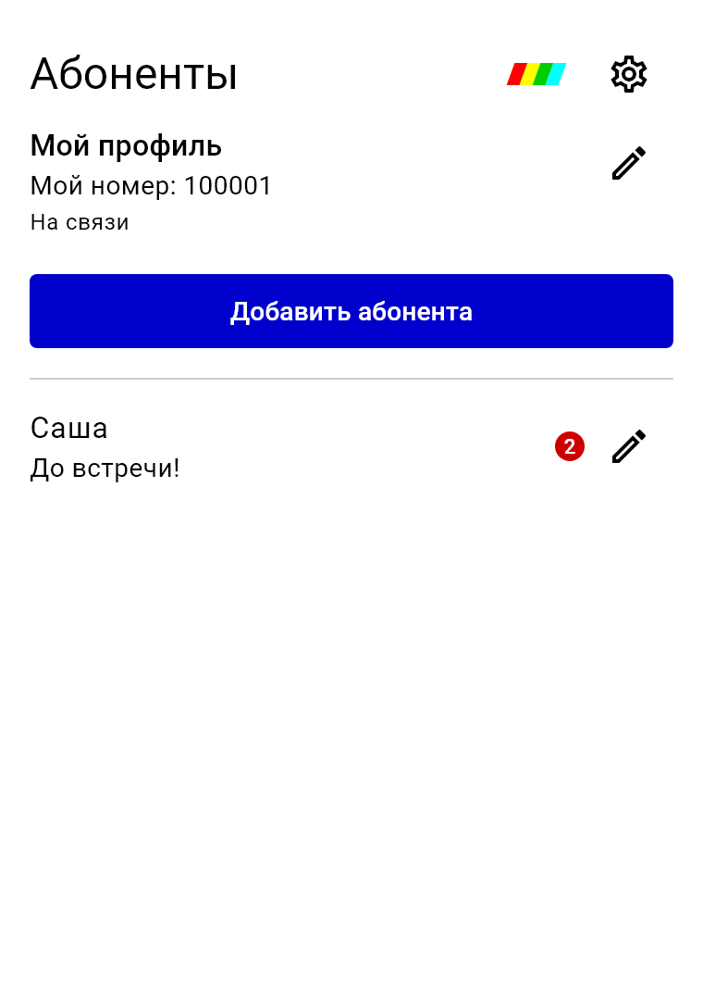
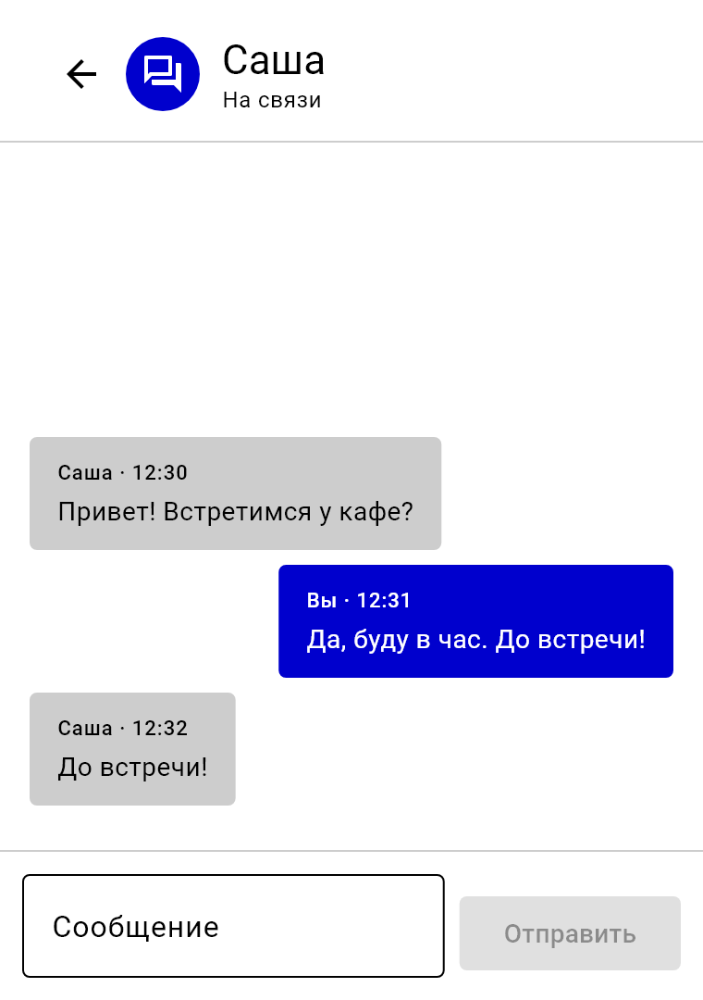

  

<h1 align="center">KitchenTable</h1>

Мессенджер для личной переписки на Android. Покажите другу свой QR-код, чтобы добавить друг друга и начать разговор.

<strong><a href="https://github.com/gagarinbefree/kitchentable/releases/latest/download/KitchenTable-Android.apk">Скачать KitchenTable для Android</a></strong>

## Как добавить друг друга

Откройте KitchenTable на обоих телефонах. На экране **«Абоненты»** дождитесь надписи **«На связи»**.

1. **На вашем телефоне** нажмите **«Добавить абонента»**. Появится ваш QR-код. Оставьте его на экране и покажите собеседнику.
2. **На телефоне собеседника** откройте **«Добавить абонента» → «Сканировать QR»**. Если Android запросит доступ к камере, разрешите его. Наведите камеру на код на вашем экране.
3. **На том же телефоне** появится вопрос с вашим номером. Собеседнику достаточно нажать **«Добавить в контакты»**. Вы сразу появитесь друг у друга в списке и сможете переписываться.

| На вашем телефоне | На телефоне собеседника |
| :---: | :---: |
|  |  |

QR-код действует **5 минут**. Если время вышло, нажмите **«Обновить мой QR»** на первом телефоне и отсканируйте новый код со второго. На скриншоте показан демонстрационный код.

## Первое сообщение

Нажмите на абонента в списке, введите текст в поле **«Сообщение»** и нажмите **«Отправить»**. На главном экране рядом с именем видно последнее сообщение. Цифра показывает, сколько входящих сообщений вы ещё не прочитали.

| Список абонентов | Личная переписка |
| :---: | :---: |
|  |  |

**Как подписать контакт.** Изначально собеседник отображается по номеру. Нажмите на карандаш рядом с ним, введите имя и сохраните. Это имя видно только вам.

**Как скрыть контакт.** Нажмите на карандаш рядом с абонентом, выберите **«Скрыть из списка»** и подтвердите. История сохранится. Когда собеседник напишет снова, диалог вернётся в список.

**Где найти настройки.** Нажмите на шестерёнку на экране **«Абоненты»**. Здесь можно выбрать светлую или чёрную тему и проверить, есть ли обновление приложения.
